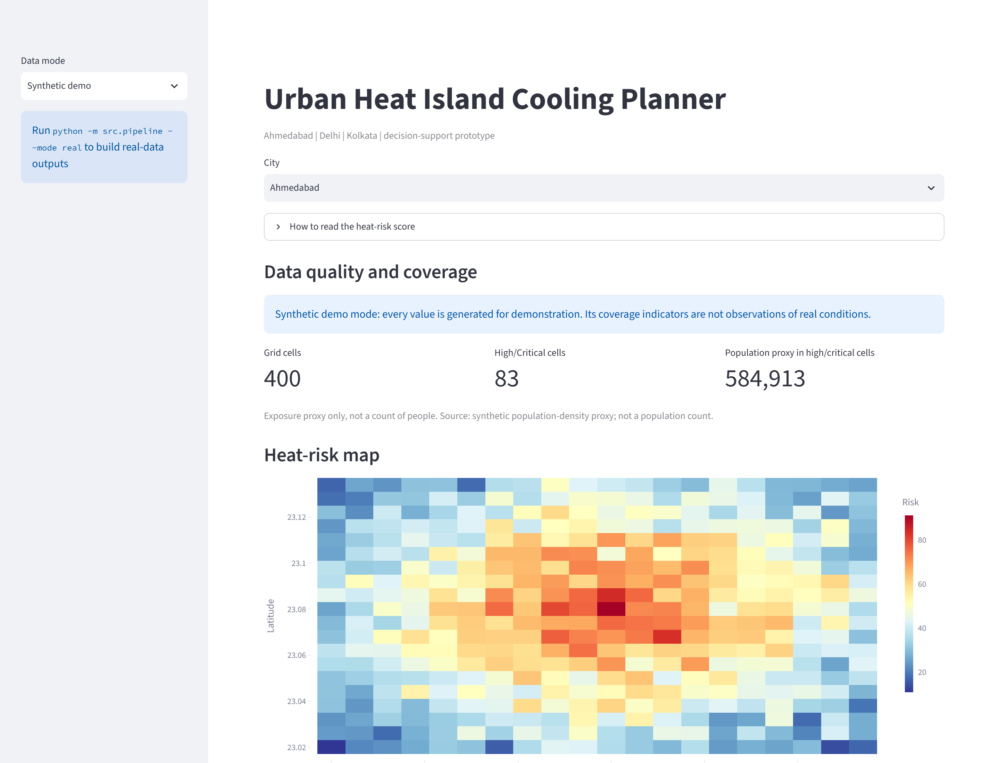

# Urban Heat Island Cooling Planner

[](https://github.com/ayush19gupta19-blip/urban-heat-island-planner/actions/workflows/ci.yml)
[](https://www.python.org/downloads/release/python-3110/)
[](LICENSE)

An environmental decision-support project for identifying heat-vulnerable parts of Ahmedabad, Delhi, and Kolkata and prioritising cooling interventions such as tree planting, cool roofs, and cooling centres.



## Current milestone

This project has two reproducible modes. The default synthetic mode is a fast demo fixture. The real mode pulls NASA POWER weather and cloud-filtered Landsat/Sentinel-2 observations through public APIs/STAC, adds WorldPop 2020 population and age-65+ estimates, builds a common city grid, derives explainable heat-risk features, ranks intervention opportunities, and serves the results through a Streamlit dashboard.

## Product question

> If a city has a limited budget, which areas should receive cooling investment first to reduce heat exposure for vulnerable residents?

## Quick start

```bash
python -m venv .venv
# Windows: .venv\Scripts\activate
pip install -r requirements.txt
python -m src.pipeline
streamlit run app/dashboard.py
```

To build the real remote-sensing feature tables for all three cities:

```bash
python -m src.pipeline --mode real --start-date 2024-04-01 --end-date 2024-06-30 --max-cloud-cover 30
```

The first real-mode run downloads and caches about 113 MB of India-wide WorldPop 2020 population and age-65+ rasters under `data/raw/worldpop/india/`. NASA POWER weather and satellite scene metadata are cached under `data/raw/`; satellite features are read from public cloud-optimized GeoTIFF assets without copying the full satellite rasters into the repository. Later runs reuse the WorldPop cache.

The synthetic pipeline writes `data/processed/heat_risk_grid.csv` and `data/processed/intervention_recommendations.csv`. The real pipeline writes the corresponding `_real.csv` files and caches inputs under `data/raw/`. Real-mode population values are modeled 2020 estimates; the municipal ward-level Census join remains pending.

## Pilot cities

- Ahmedabad
- Delhi
- Kolkata

The local baseline generates a separate 20x20 analysis grid for each city and provides a city selector in the dashboard. These city profiles are synthetic and must be calibrated against local observations before operational use.

## Architecture

```text
Raw/provider data -> ingestion -> feature engineering -> heat-risk model
                                      |                    |
                                      v                    v
                                geospatial grid -> intervention ranking -> dashboard
```

## Planned data sources

- Landsat/Sentinel-derived land-surface temperature and vegetation indices
- NASA POWER or ERA5 weather data
- OpenStreetMap buildings, roads, parks, and water bodies
- WorldPop or official census population and vulnerability data

The public repository will contain only openly licensed, synthetic, or aggregated data.

The confirmed dataset inventory and city-by-city coverage matrix are documented in [`docs/dataset_inventory.md`](docs/dataset_inventory.md).
The scoring assumptions, intervention logic, calibration plan, and responsible-use constraints are documented in [`docs/methodology.md`](docs/methodology.md).

## Project status

- [x] Scope and pilot city selected
- [x] Reproducible synthetic grid baseline
- [x] Explainable heat-risk scoring
- [x] Budget-aware intervention ranking
- [x] Initial dashboard
- [x] Public dataset availability confirmed for Ahmedabad, Delhi, and Kolkata
- [x] NASA POWER weather ingestion
- [x] Landsat land-surface-temperature and built-up proxy ingestion
- [x] Sentinel-2 NDVI and water-surface proxy ingestion
- [x] Real-data feature builder with city-wide weather summaries
- [x] WorldPop 2020 population counts and age-65+ vulnerability grid
- [ ] Municipal ward-level vulnerability join (Census ward tables and matching boundaries)
- [ ] Spatial model validation against observed temperature
- [ ] Historical trend and uncertainty analysis

## Checks

```bash
pytest -q
```

## Limitations

The current baseline is a planning prototype, not a public-health warning system. Its coefficients and intervention effects are assumptions until calibrated against local observations and domain-expert review.
